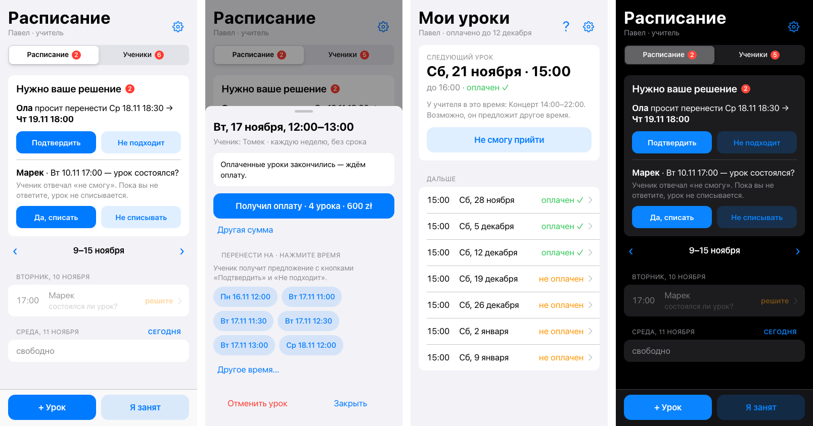
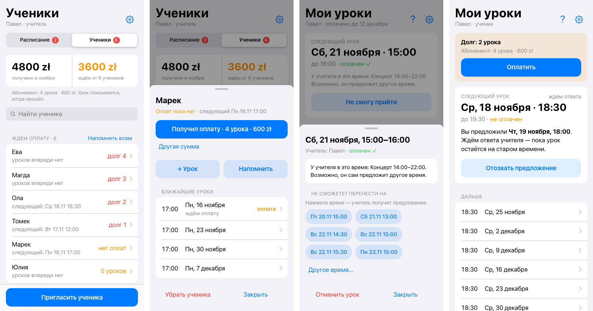

# SlotMate

A free Telegram Mini App for scheduling private lessons — built for a drum teacher and their students, usable for any one-on-one hobby (music, tennis, chess, language tutoring).

**One rule drives everything: a lesson time changes only when both sides confirm.** Until the other person answers, the lesson stays where it was. No more "wait, was it Saturday or Sunday?".



> The app interface is in Russian for now. Try the live bot: [@Slot_Mate_Bot](https://t.me/Slot_Mate_Bot).

## Features

**Rescheduling without chaos**
- Either side proposes a new time → the other gets a Telegram message with *Confirm* / *Doesn't work*.
- One tap to propose: open a lesson (students: *Can't make it*) and tap one of the suggested free slots. A toast lets you withdraw it.
- Busy times can't be proposed: other lessons, the teacher's "I'm busy" marks (gigs, trips). Moving a whole weekly series checks every date.
- Unanswered proposals expire on their own; if a lesson starts with an open question, the teacher decides whether it happened.
- Teacher marks a gig → every affected lesson gets a reschedule proposal with suggested free slots in one tap.

**Weekly lessons with no end date**
- "Every week" means every week — the schedule extends itself. Stop it with *Cancel → this and all following*.

**Packages and payments, one tap**
- Students buy packages (e.g. 4 lessons). A lesson is deducted after it happens — not while a question about it is still open.
- On the day of the first unpaid lesson, the teacher gets a Telegram message with a single **Payment received** button.
- Students and payments live in one list: who owes is on top, and recording a payment is one tap in the student's card.
- Students see *"Paid until December 6"* and which lessons are paid. A **Pay** button appears only when the package runs out (online payment is coming later).
- Late-cancellation rule (none / 6 / 12 / 24 h), payment reminders, full payment history.

**Everything else**
- Reminders a day before ("Coming" / "Can't make it"), evening summary for the teacher.
- Calendar subscription link for iPhone and Google Calendar.
- iOS-style design, follows Telegram's light and dark themes.
- Demo teacher dashboard with fake students for the bot owner.



## How it works

| Part | What |
|---|---|
| Runtime | One [Cloudflare Worker](https://developers.cloudflare.com/workers/) (free plan) |
| Database | Cloudflare D1 (SQLite) |
| Interface | Telegram Mini App — a single HTML page served by the worker |
| Notifications | Telegram Bot API; an hourly cron sends reminders and closes expired proposals |
| Auth | Telegram `initData` signature check (HMAC), webhook secret token |

No frameworks, no build step beyond gluing two files together.

```
code/
  app/worker.src.js   server: API, bot, reminders, database
  app/app.html        the Mini App screen
  app/build.mjs       glues them into app/slotmate-app.js (the file you deploy)
  tests/              API tests on an in-memory SQLite + fake Telegram, screenshot test
design/               process map and screenshots
archive/              v1: the chat-bot version that was replaced by the Mini App
```

## Run the tests

Requires Node.js 22+ (uses the built-in `node:sqlite`).

```bash
cd code
npm install
npm test            # API and bot logic
npx playwright install chromium
npm run screens     # renders every screen to code/tests/screens/
```

## Deploy your own

1. Create a bot with [@BotFather](https://t.me/BotFather) and copy its token.
2. Cloudflare → Workers → create a worker. Add a D1 database binding named `DB` and a secret `BOT_TOKEN`.
3. Add a cron trigger: `0 * * * *`.
4. `cd code && npm run build`, paste `app/slotmate-app.js` into the worker editor, deploy.
5. Open `https://<your-worker>.workers.dev/setup` once. The first person to press *Start* in the bot becomes the owner and can invite a teacher.

Running `/setup` again later requires a `SETUP_KEY` secret: `/setup?key=<SETUP_KEY>`.

## Status

Used by a real drum teacher and their students since November 2026. Ideas on the list: email notifications, a single app for any hobby where you find your teacher or coach.

## License

[MIT](LICENSE)
